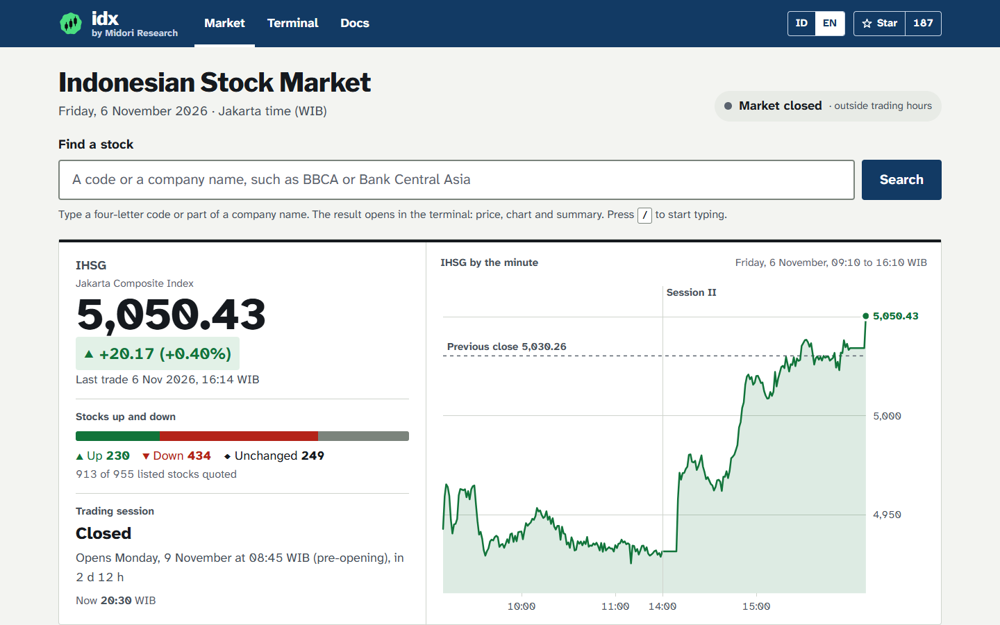
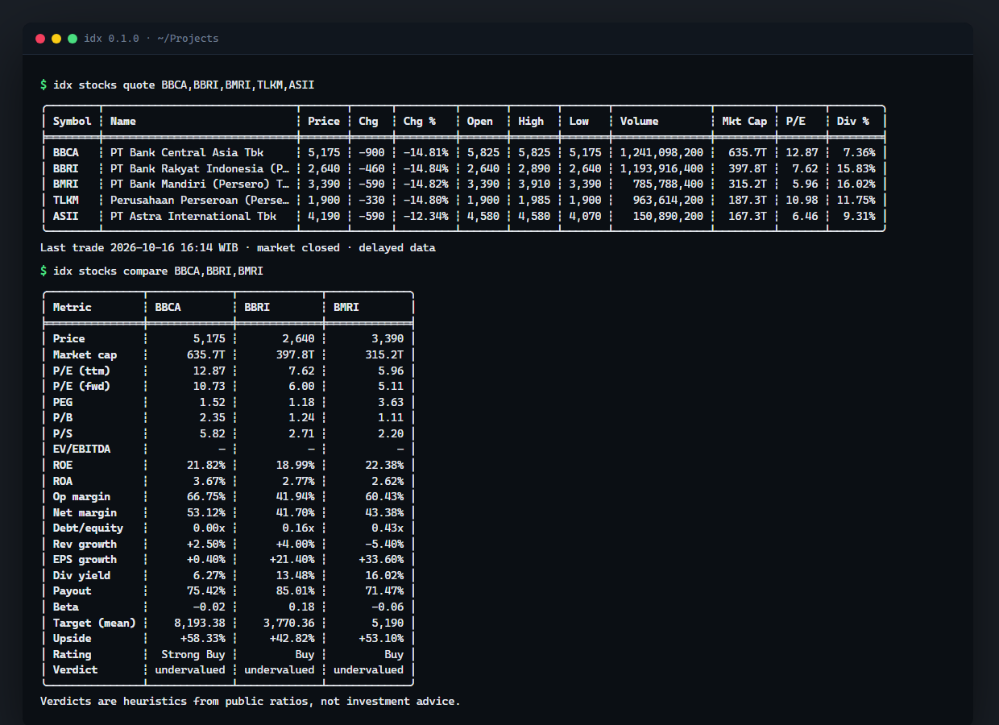
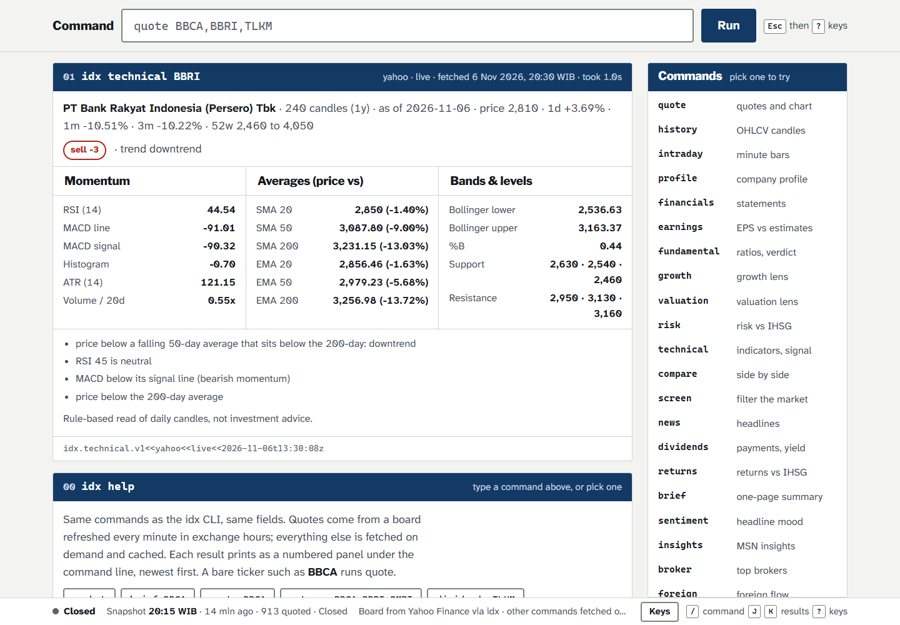

<p align="center">
  <picture>
    <source media="(prefers-color-scheme: dark)" srcset="assets/logo-dark.svg">
    <source media="(prefers-color-scheme: light)" srcset="assets/logo-light.svg">
    
  </picture>
</p>

<p align="center">
  Indonesian stock market (IDX / IHSG) analysis for people and AI agents.<br>
  One binary: a CLI that prints tables, a JSON mode for scripts, and an MCP server for agents.
</p>

<p align="center">
  <a href="https://github.com/fzn0x/idx/actions/workflows/ci.yml"></a>
  <a href="LICENSE"></a>
  <a href="https://ihsg.midoriresearch.com"></a>
</p>

---

<p align="center">
  <a href="https://ihsg.midoriresearch.com"></a>
</p>

```sh
idx stocks quote BBCA,BBRI,TLKM
```

```
╭────────┬──────────────────────────────┬───────┬──────┬─────────┬───────┬───────┬───────┬───────────────┬─────────┬───────┬────────╮
│ Symbol ┆ Name                         ┆ Price ┆ Chg  ┆ Chg %   ┆ Open  ┆ High  ┆ Low   ┆ Volume        ┆ Mkt Cap ┆ P/E   ┆ Div %  │
╞════════╪══════════════════════════════╪═══════╪══════╪═════════╪═══════╪═══════╪═══════╪═══════════════╪═════════╪═══════╪════════╡
│ BBCA   ┆ PT Bank Central Asia Tbk     ┆ 5,175 ┆ -900 ┆ -14.81% ┆ 5,825 ┆ 5,825 ┆ 5,175 ┆ 1,241,098,200 ┆  635.7T ┆ 10.96 ┆  6.27% │
│ BBRI   ┆ PT Bank Rakyat Indonesia (P… ┆ 2,640 ┆ -460 ┆ -14.84% ┆ 2,640 ┆ 2,890 ┆ 2,640 ┆ 1,193,916,400 ┆  397.8T ┆  6.49 ┆ 13.48% │
│ TLKM   ┆ Perusahaan Perseroan (Perse… ┆ 1,900 ┆ -330 ┆ -14.80% ┆ 1,900 ┆ 1,985 ┆ 1,900 ┆   963,614,200 ┆  187.3T ┆ 10.98 ┆ 10.01% │
╰────────┴──────────────────────────────┴───────┴──────┴─────────┴───────┴───────┴───────┴───────────────┴─────────┴───────┴────────╯
Last trade 2026-10-16 16:14 WIB · market closed · delayed data
```

```sh
idx -o json stocks quote BBCA | jq '.data[0] | {price, change_pct, pe_trailing, dividend_yield_pct}'
```

```json
{ "price": 5175.0, "change_pct": -14.814815, "pe_trailing": 10.963983, "dividend_yield_pct": 6.27 }
```

<p align="center">
  
</p>

- **Free data, no keys.** Yahoo Finance and MSN Money for prices and
  fundamentals, the exchange's own idx.co.id summaries for foreign flow,
  member activity, indices and the corporate-action calendar, IDX's monthly
  KSEI register for ownership, Indo Premier's broker summary for who bought
  and sold (read as bandarmology by `idx bandar`) and for foreign flow in
  rupiah (`stocks foreign --source ipot`), its corporate-action
  pages, Kontan and CNBC Indonesia feeds for news. Every source sits behind a `Provider` trait, so
  one breaking does not take the tool down, and `auto` fills gaps in one
  source's fundamentals from the other.
- **Built for agents.** `-o json` emits a stable, schema-documented envelope
  (`idx schema quotes`), `-o jsonl` one record per line. Exit codes mean
  something, and `-` reads tickers from stdin so commands chain. `idx mcp`
  exposes every command as a typed MCP tool that returns the very same JSON.
- **Works offline.** Responses are cached with per-endpoint TTLs; `--offline`
  serves the cache instead of failing when the network is gone.
- **Ownership, not just prices.** KSEI's monthly register of holders above 1 %
  is imported into local SQLite with normalised entity names, so "who owns
  more than 1 % of BBCA" and "what did this fund change last month" are one
  command each. The monthly IDX files are mirrored to GitHub, so neither you
  nor the web terminal imports anything by hand: `idx ownership sync`
  installs every month in one download.
- **Single static binary.** Rust, no runtime, Linux / macOS / Windows.

## Install

The package is called **`ihsg-cli`**; the command it installs is **`idx`**
(npm also adds `ihsg-cli` as an alias).

```sh
cargo install --locked ihsg-cli           # crates.io, builds from source (Rust 1.89+)
npm install -g ihsg-cli                   # npm
npx ihsg-cli stocks quote BBCA            # npm, no install
curl -fsSL https://raw.githubusercontent.com/fzn0x/idx/main/install.sh | sh   # Linux, macOS
nix profile install github:fzn0x/idx      # Nix (Linux; Apple silicon macOS untested), with shell completions
nix run github:fzn0x/idx -- stocks quote BBCA   # Nix, no install
```

npm installs a small launcher; the first `idx` command downloads the
prebuilt binary for your platform from the matching GitHub release and checks
it against the release's `SHA256SUMS` (so does `install.sh`). The binary is
stored next to the launcher, or in a per-user cache when the global npm
folder is not writable. `npm install -g github:fzn0x/idx` installs the same
launcher from this repository's `main`; npm 12 only installs from git with
`--allow-git=all`.

Windows without npm: download `idx-<version>-x86_64-pc-windows-msvc.zip` from
the [releases page](https://github.com/fzn0x/idx/releases). Static Linux
binaries are musl builds and run on any distribution. The development version installs
with `cargo install --git https://github.com/fzn0x/idx`.

Nix builds idx from source on your machine (there is no binary cache), so the
first `nix profile install` or `nix run` takes several minutes. The bare
`github:fzn0x/idx` ref follows `main`; add a release tag to pin one, as in
`github:fzn0x/idx/v0.8.2` (the first release with the flake). For MCP clients,
install once and register `$HOME/.nix-profile/bin/idx`, written as an absolute
path, with the argument `mcp`: `idx mcp setup` prints the binary's resolved
`/nix/store` path, which an upgrade followed by garbage collection removes.
`nix run github:fzn0x/idx#mcp` starts the same server without installing, for
trying it from a terminal; do not make it a client's server command, because a
cold start (the first run, or the first after `main` moves) builds idx before
the server answers, which takes longer than clients wait. `overlays.default`
adds `pkgs.idx` for NixOS and home-manager configurations, and `nix develop` in
a clone gives the toolchain from `rust-toolchain.toml` plus Node for `web/`. On
NixOS, point `idx stockbit login` at a browser with
`IDX_BROWSER=$(command -v chromium)`.

Shell completions:

```sh
idx completions bash > ~/.local/share/bash-completion/completions/idx
idx completions zsh  > ~/.zfunc/_idx
idx completions fish > ~/.config/fish/completions/idx.fish
idx completions powershell | Out-String | Invoke-Expression
```

## Commands

| command | what it does |
| --- | --- |
| `stocks quote <SYMBOLS>` | Delayed quote for one or many tickers (`BBCA,BBRI` or `BBCA BBRI`; `.JK` optional; `-` reads them from stdin; another Yahoo Finance market by its suffix, e.g. `D05.SI`) |
| `stocks history <SYMBOL> [--period 1y] [--interval 1d] [--limit 30]` | OHLCV candles with a summary line. Periods `1d 5d 1mo 3mo 6mo 1y 2y 5y 10y ytd max`, intervals `1m 2m 5m 15m 30m 1h 1d 1wk 1mo` (`1m` covers at most `5d`, `2m` at most `1mo`) |
| `stocks intraday <SYMBOL> [--interval 1m] [--limit 15]` | The latest session by the minute (today's while the market trades, otherwise the last one): OHLCV bars, the quote with its previous close and change, and a summary of the bars with VWAP computed by idx. Yahoo's chart, no login, about 10 minutes behind the market; works for IHSG (`^JKSE`) too. `--provider stockbit` makes the bars realtime |
| `stocks profile <SYMBOL>` | Sector, industry, description, size, headquarters, management |
| `stocks financials <SYMBOL> [--period annual\|quarterly\|ttm] [--statement income,balance,cash]` | Income statement, balance sheet, cash flow; `--statement` (comma-separated or repeated, `all` by default) picks the tables shown |
| `stocks earnings <SYMBOL> [--annual\|--quarterly] [--reported\|--estimates]` | Quarterly EPS vs estimates with surprise, yearly and quarterly revenue/earnings, analyst consensus for this and next quarter and fiscal year, next earnings date; the flags keep only those rows in every format (`--history`/`--forecast` are aliases) |
| `stocks dividends <SYMBOL>` | Every cash dividend (ex-date, split-adjusted amount) and split; yearly totals, TTM total and yield, payout streak |
| `stocks returns <SYMBOLS> [--benchmark ^JKSE]` | 1w/1m/3m/6m/YTD/1y/3y/5y returns, CAGR, volatility, max drawdown, best/worst day, 52-week position, and excess over IHSG |
| `stocks brief <SYMBOL>` | One page: quote, verdict, signal, returns vs IHSG, dividends, top holders, headlines, with plain-language key points |
| `stocks fundamental <SYMBOL>` | P/E, P/B, PEG, EV/EBITDA, ROE, ROA, margins, leverage, growth, dividend, analyst targets, plus a plain-language verdict that lists every rule it applied (negative equity counts against a company; multiples that mix USD statements with an IDR price are marked and not scored) |
| `stocks growth <SYMBOL>` | Growth lens: latest-quarter revenue and earnings growth, forward EPS against trailing, and revenue and net income across the annual statements (CAGR, how often revenue grew, a turn from profit to loss); every rule with its points, every skipped rule with the reason |
| `stocks valuation <SYMBOL>` | Valuation lens: P/E, PEG, P/B, P/S, EV/EBITDA, dividend yield and the analyst target (3 or more analysts), each scored; multiples that mix USD statements with an IDR price are shown, not scored |
| `stocks risk <SYMBOL>` | Risk lens: negative equity, debt/equity, current ratio, losses, and beta, volatility and largest fall against IHSG over a year of daily closes (computed by idx, not the source's beta). `stocks fundamental <SYMBOL> --lens growth\|valuation\|risk` gives the same three readings |
| `stocks technical <SYMBOL> [--period 1y]` | RSI, MACD, SMA/EMA 20/50/200, Bollinger, ATR, volume, support/resistance, trend, buy/sell/neutral signal with reasons |
| `stocks compare <SYMBOLS>` | Side-by-side fundamentals for two or more tickers |
| `stocks screen [--preset P] [-f "pe<15,roe>15,sector=financial"] [--sort KEY] [--asc\|--desc] [--returns]` | Screener over ~950 IDX tickers: one batch quote for valuation/size/dividend keys and `range` (position in the 52-week range), one request for MSN's whole-market list for the return keys `ret1w ret1m ret3m ret6m retytd ret1y`, per-company fundamentals for the rest (capped, largest first). Presets defined by idx: `top-performers`, `worst-performers`, `high-dividend`, `low-pe`, `52w-high`, `52w-low`, `high-volume`, `large-cap` |
| `stocks news [SYMBOL] [--company-only] [--source kontan\|cnbcindonesia\|all]` | Headlines from Kontan and CNBC Indonesia RSS. With a ticker, the company's headlines come first, then market context fills the limit |
| `stocks sentiment <SYMBOL>` | Aggregate lexicon sentiment over the matching headlines, with counts, terms and the strongest headlines |
| `stocks insights <SYMBOL> [--all]` | MSN Money's rule-based statements (about 30, in Valuation, Earnings, Growth, Performance, Health), each rated good, bad, neutral or not rated against the peers, the industry, the company's own history or the price, with the peer tickers |
| `stocks actions <SYMBOL> [--since D]` | Corporate actions from IPOT, upcoming ones included: cash and stock dividends, splits, bonus shares, rights issues (amount, ratio old:new, cum, ex, recording and payment dates, status, announcement), shareholders' meetings (RUPS: time, venue, agenda), listed warrants and rights |
| `stocks foreign <SYMBOL> [--days 20 \| --from D --to D] [--source idx\|ipot]` | Foreign buying and selling per session, totals and the net-buy/net-sell streak: from idx.co.id by default (shares on the regular board, as IDX publishes them, net and net × close), or from IPOT with `--source ipot` (rupiah across all boards, value traded and foreign share; works where idx.co.id refuses the connection) |
| `stocks list [--board B] [--search S]` | Listed stocks from idx.co.id with listing board, listing date and shares; the bundled universe stands in offline |
| `ownership import --latest\|--all [--family composition]\|--file F\|--url U` | Import KSEI's monthly ">1 % holders" register (XLSX or PDF) into local SQLite. `--latest`/`--all` read idx.co.id and fall back to the CI-maintained GitHub mirror. `--family composition`, or a ZIP/TXT given to `--file`/`--url`, imports KSEI's composition archive into its own tables |
| `ownership sync [--force]` · `ownership status` | Install the prebuilt SQLite snapshot CI builds from the mirrored files (one download, SHA-256 checked), then any newer month; a database holding months the snapshot lacks is kept unless `--force` (a `.bak` copy is kept). `status` shows the local database, the mirror and what sync would do |
| `ownership ticker <SYMBOL> [--as-of D]` | Holders above 1 % of a ticker (a holder's accounts summed; controller/affiliate flag from the 30 Oct 2026 register) |
| `ownership entity "<NAME>" [--as-of D] [--exact]` | Every position of a person or institution, spelling variants grouped (`--exact`: one holder by its key) |
| `ownership search "<NAME>" [--limit N] [--as-of D]` | Find holders by name in every imported month: every spelling KSEI printed, words in any order, with the key for `entity --exact` |
| `ownership cross-holders [--min-issuers N] [--type T] [--origin foreign\|local]` | Holders ranked by the number of issuers they own more than 1 % of, with every position |
| `ownership concentration [SYMBOLS] [--by hhi\|top1\|top3] [--ascending]` | Issuers ranked by disclosed ownership concentration: HHI over the listed holders, largest and top-3 stakes, undisclosed percent, controller stake |
| `ownership graph <ROOT> [--depth N] [--min-pct P] [--max-nodes N] [--dot]` | Holder-issuer network around a ticker or holder, as a table, JSON or Graphviz DOT |
| `ownership resolve candidates\|merge\|map\|list\|undo` | Suggest, merge and split holder spellings KSEI printed differently between months (rules stored in the local database, undoable) |
| `broker <SYMBOLS> [--date D \| --from D --to D] [--investor all\|foreign\|domestic] [--board all\|regular\|cash\|negotiated]` | Broker summary: the top 10 buyers and sellers of a ticker (ranked by lots), with broker name, class (local, foreign, BUMN), lots, value and average price, plus total value and foreign net (for one investor side, what it bought and sold). Latest session with trades by default; `-o csv` gives one row per broker |
| `bandar detect <SYMBOLS> [--period 1d\|1w\|1m\|3m] [--top 1\|3\|5\|10] [--daily]` | Bandarmology: are the top brokers accumulating or distributing? The top 1/3/5/10 buyers against as many sellers (bandar value and volume), net as a share of the value traded, the phase against the price move, the top buyers' average against the price, foreign flow; `--daily` adds the bandar movement session by session. See [Bandarmology](#bandarmology) |
| `bandar screen [--preset P] [-f FILTER] [--period P] [--scan N]` | Bandarmology screener over the 100 most traded stocks by value: presets `big-accumulation`, `accumulation`, `distribution`, `big-distribution`, `quiet-accumulation`, `quiet-distribution`, `foreign-accumulation`, `below-bandar`, or filters on `acc`, `net`, `fnet`, `fpct`, `gain`, `chg`, `turnover`, `conc`, `signal`, `phase` |
| `bandar broker <CODE> [--period P] [--scan N \| --symbols S]` | Broker activity: where one broker (e.g. `YP`) sits among the top 10 buyers or sellers of the 100 most traded stocks, with rank, lots, value, average, share of the stock's value and net where both sides are visible |
| `market overview [--top 10]` | IHSG, breadth, turnover, gainers, losers, most traded, heavyweights from one pass over the universe |
| `market foreign [--date D] [--top 10] [--sort value\|shares]` | Top foreign net buying and net selling across every stock for one session (idx.co.id), with the market's foreign totals |
| `market brokers [--date D] [--top 20] [--sort value\|volume\|frequency]` | Every exchange member's trading for one session, ranked, with each member's share of all members' value |
| `market indices [CODE...] [--date D]` | Every IDX index (IHSG, LQ45, IDX30, sector and thematic) for one session: close, change, range, constituents, value, market cap |
| `market calendar [--from D --to D \| --date D] [--symbol S] [--type T]` | The exchange calendar: dividend and rights dates (cum, ex, recording, payment), RUPS, public exposes, listings; bonds and buyback reports with `--type all`. Default: the next 14 days |
| `market holidays [--year Y \| --all] [--upcoming]` | Trading holidays (Kalender Libur Bursa, bundled), the year's trading days, whether today is a trading day and the next one |
| `market astro [--date D] [--days N] [--natal launch\|base\|none] [--backtest [--period P]]` | Traditional astrology for IHSG, computed offline: the Sun, Moon and planets (sign, degree, speed, retrograde) at 16:00 WIB, Moon phase, Mercury retrograde, Javanese weton, Chinese shio, phases, stations and ingresses ahead, aspects to IHSG's chart; `--backtest` tests them on IHSG's daily returns. See [Astrology](#astrology) |
| `market members [--search S]` | Exchange members (broker codes) with names and licences |
| `ownership changes --from D --to D [--symbol S] [--min-change PP] [--limit N --offset N]` | New holders, exits and position changes between two months, paged, with a summary (counts, foreign vs local net, by investor type, issuer flow, top moves) over every match |
| `ownership foreign [SYMBOL] [--from D --to D]` | Disclosed foreign (KSEI `A`) vs local stake: one issuer month by month, or every issuer's change between two months |
| `ownership composition <SYMBOL> [--as-of D]` | KSEI's monthly "Kepemilikan Efek" archive: local vs foreign shares in nine investor types, as a percent of the scripless shares, with the scripless share of listed shares and the trend over imported months. Downloads the newest month on first use |
| `ownership institutions <SYMBOL>` | Institutional and fund holders from MSN Money (live, no import): shares, % of shares outstanding, the change since each holder's last report and a `new`/`buyer`/`seller`/`exited`/`unchanged` signal, with institutional, fund and free-float percentages and counts per list. See [docs/ownership.md](docs/ownership.md#institutional-and-fund-holders-msn) |
| `stockbit login [--page [--port N]] \| status \| logout` | Opt-in: store your own Stockbit session, signed in in a browser idx opens or, over SSH and for Google sign-in, through a page on 127.0.0.1 for your own browser (idx never sees the password; every session is checked before it is stored); check when its tokens expire; delete it. See [docs/stockbit.md](docs/stockbit.md) |
| `stockbit orderbook <SYMBOL>` | The live depth ladder and session foreign flow (your Stockbit session) |
| `stockbit actions <SYMBOL> [--kind K] [--from D --to D]` · `stockbit calendar [--from D --to D \| --days N] [--kind K]` | Corporate actions from your Stockbit session, one structured row each: a stock's whole history (dividends since 2009 for BBCA, splits, bonus, rights, warrants, RUPS, public exposes, tender offers), or the market's calendar with rights, tender and IPO offers still open |
| `stockbit movements [SYMBOL] [--from D --to D] [--holder ID] [--action A] [--source idx\|ksei] [--pages N]` | Insider and 5 % holder movements from your Stockbit session: IDX insider disclosures (with the trade price) and KSEI's 5 % holder changes (Stockbit's estimated price kept apart), shares exact and signed |
| `watch [add\|rm\|list\|clear\|returns]` | Plain-text watchlist next to the config; `idx watch` quotes it |
| `ownership releases\|discover [--family F --limit N]\|path` | Imported months, files published on idx.co.id and ksei.co.id (families `above1`, `above5`, `investor-type`, `classification`, `composition`, `all`, each marked `importable`), database path |
| `mcp [--http ADDR --token T]` · `mcp setup <client>` | MCP server over stdio or streamable HTTP, and the registration recipe for 25 agent harnesses. 47 tools: `idx_brief`, `idx_market`, `idx_quote`, `idx_history`, `idx_intraday`, `idx_profile`, `idx_financials`, `idx_earnings`, `idx_dividends`, `idx_returns`, `idx_fundamental`, `idx_technical`, `idx_compare`, `idx_screen`, `idx_news`, `idx_sentiment`, `idx_insights`, `idx_corporate_actions`, `idx_foreign`, `idx_instruments`, `idx_market_foreign`, `idx_market_brokers`, `idx_indices`, `idx_calendar`, `idx_holidays`, `idx_astro`, `idx_members`, `idx_broker`, `idx_bandar`, `idx_bandar_screen`, `idx_bandar_broker`, `idx_ownership_ticker`, `idx_ownership_entity`, `idx_ownership_changes`, `idx_ownership_foreign`, `idx_ownership_releases`, `idx_ownership_search`, `idx_ownership_rankings`, `idx_ownership_graph`, `idx_ownership_composition`, `idx_ownership_snapshot`, `idx_ownership_institutions`, `idx_orderbook`, `idx_stockbit_status`, `idx_stockbit_login`, `idx_stockbit_actions`, `idx_stockbit_movements` |
| `schema [name]` | JSON Schema for every payload (`quotes`, `history`, `intraday`, `profile`, `fundamentals`, `growth`, `valuation`, `risk`, `compare`, `financials`, `earnings`, `dividends`, `returns`, `market`, `brief`, `technical`, `screen`, `news`, `sentiment`, `insights`, `actions`, `foreign`, `foreign-value`, `instruments`, `market-foreign`, `market-brokers`, `indices`, `calendar`, `holidays`, `astro`, `members`, `broker`, `bandar`, `bandar-screen`, `bandar-broker`, `ownership-*`, `stockbit-*`, `watchlist`, `error`, ...) |
| `config init\|set\|get\|path` | Config file management |
| `cache stats\|clear\|path` | Response cache management |
| `completions <shell>` | bash, zsh, fish, powershell, elvish |
| `version` | Version, build and default paths |

Global flags work anywhere on the line:

| flag | env | meaning |
| --- | --- | --- |
| `-o, --output table\|json\|jsonl\|csv\|auto` | `IDX_OUTPUT` | Output format: tables for people, the JSON envelope for programs, one JSON record per line (`jsonl`), CSV rows of the payload's main list for spreadsheets; `auto` is a table on a terminal and the JSON envelope when piped (opt-in: the default stays `table`) |
| `--provider auto\|yahoo\|msn\|stockbit` | `IDX_PROVIDER` | Data source (`auto` tries Yahoo, then MSN, and merges fundamentals; `stockbit` is opt-in realtime from your own session, see [docs/stockbit.md](docs/stockbit.md)) |
| `--history-provider auto\|yahoo\|stockbit` | `IDX_HISTORY_PROVIDER` | Where candles come from; `auto` follows `--provider` (Yahoo for `msn`; under `stockbit`, Stockbit where its bars match the request and Yahoo otherwise or when Stockbit fails). See [docs/configuration.md](docs/configuration.md#history-provider) |
| `--offline` | `IDX_OFFLINE=1` | Never touch the network |
| `--no-cache` | `IDX_NO_CACHE=1` | Ignore cached responses |
| `--timeout SECS` | `IDX_TIMEOUT_SECS` | Per-request timeout (default 15) |
| `--no-color` | `NO_COLOR` | Plain tables |
| `-v, -vv, -vvv` | `IDX_LOG` | Diagnostics on stderr, including every URL requested |
| `-q, --quiet` | `IDX_QUIET=1` | stderr carries errors only: no warnings, notes or loading line. stdout is unchanged and `-o json` keeps `warnings` in the envelope |
| | `IDX_EXCHANGE=SI` | Yahoo Finance suffix a bare ticker gets in `stocks quote`, `history`, `profile`, `financials`, `earnings`, `dividends`, `returns`, `fundamental`, `technical`, `compare` and `watch` (default `JK`, IDX). An explicit suffix (`D05.SI`) always works there; every other command reads IDX tickers only |
| | `IDX_PROGRESS=never\|always` | The loading line on stderr (`⠹ 6s · waiting on investasi.kontan.co.id 6s`) shows on a terminal only; `never` hides it, `always` forces it |

## For scripts and agents

```sh
idx -o json stocks history TLKM --period 1y --interval 1wk \
  | jq '.data.summary.change_pct'
idx -o jsonl market holidays --year 2026 | jq -r .date      # one record per line
idx -o jsonl stocks screen -f 'pe<10,roe>15' -n 5 | idx stocks compare -
echo BBCA BBRI | idx stocks quote -                         # tickers from stdin
idx -q -o csv stocks quote BBCA BBRI > quotes.csv           # stderr: errors only
```

- stdout carries exactly one JSON document (`-o json`) or one JSON record per
  line (`-o jsonl`); everything else goes to stderr. Errors are one JSON line
  on stderr in both modes.
- `-o auto` (or `IDX_OUTPUT=auto`) prints a table on a terminal and the JSON
  envelope when stdout is piped or captured.
- `-` in a ticker list (`stocks quote|returns|compare`, `broker`, `bandar`,
  `watch add|rm`) reads tickers from stdin: plain text (spaces, commas or lines,
  `#` comments) or idx's own `-o json` / `-o jsonl` output.
- The envelope records `provider`, `fetched_at`, `cached`, `stale`, `stale_reason` (`offline` or `fetch_failed`, only when stale) and `warnings`.
- Fields the source did not return are `null`. Nothing is estimated.
- Quotes carry `behind_session`: `true` when the last trade is dated before the latest IDX session that has ended (a suspended stock, one that did not trade, or a source that lags the close), using the bundled holiday calendar.
- Exit codes: `0` ok · `2` usage · `3` network/provider (JSON code `blocked` when the source's bot protection, Cloudflare, refused this network) · `4` not found · `5` offline cache miss · `6` config.

Full field reference: [docs/json-output.md](docs/json-output.md).
Configuration and cache: [docs/configuration.md](docs/configuration.md).
Calling idx from an agent (rules, exit codes, recipes, an agent-led install):
[docs/agent-guide.md](docs/agent-guide.md).

### MCP server

`idx mcp` serves the Model Context Protocol over stdio, which is what every
local agent launches. `idx mcp --http` serves the same tools over streamable
HTTP for products that only connect to a URL. `idx mcp setup <client>` prints
the exact command or config snippet for your agent with the absolute path of
the binary filled in, because GUI apps rarely inherit your shell `PATH`:

```sh
idx mcp setup --list          # every supported client
idx mcp setup codex           # prints: codex mcp add idx -- /abs/path/idx mcp
idx mcp setup muse            # prints the settings.json block Meta's Muse Code expects
```

| agent | register idx |
| --- | --- |
| Claude Code | `claude mcp add --scope user idx -- idx mcp` |
| Claude Desktop | `claude_desktop_config.json` → `"mcpServers": {"idx": {"command": "idx", "args": ["mcp"]}}` |
| OpenAI Codex (CLI, IDE extension, app) | `codex mcp add idx -- idx mcp`, or `[mcp_servers.idx]` with `command`/`args` in `~/.codex/config.toml` |
| Meta Muse Code | `~/.config/muse/settings.json`: `{"schema_version": 1, "mcp_servers": {"idx": {"transport": "stdio", "command": "idx", "args": ["mcp"], "mode": "optional"}}}` |
| Google Antigravity (IDE, CLI) | `~/.gemini/config/mcp_config.json` → `mcpServers.idx` with an absolute `command` and no `type` field |
| Gemini CLI | `gemini mcp add -s user idx idx mcp` |
| GitHub Copilot CLI | `copilot mcp add idx -- idx mcp` |
| VS Code (Copilot agent mode) | `code --add-mcp '{"name":"idx","command":"idx","args":["mcp"]}'`, or `.vscode/mcp.json` → `servers.idx` with `"type": "stdio"` |
| Cursor · Windsurf · JetBrains · Warp · Trae · Augment | paste `{"mcpServers": {"idx": {"command": "idx", "args": ["mcp"]}}}` into the MCP settings (file paths in `idx mcp setup`) |
| Kiro (IDE and CLI, formerly Amazon Q Developer CLI) | `~/.kiro/settings/mcp.json`, or `kiro-cli mcp add --name idx --command idx --args mcp` |
| Zed | `settings.json` → `"context_servers": {"idx": {"command": "idx", "args": ["mcp"], "env": {}}}` |
| Cline · Roo Code · Kilo Code | MCP Servers → Configure → `mcpServers.idx` with `"type": "stdio"` |
| Continue | `~/.continue/mcpServers/idx.yaml` (`idx mcp setup continue` prints it) |
| OpenCode | `opencode.json` → `"mcp": {"idx": {"type": "local", "command": ["idx", "mcp"], "enabled": true}}` |
| Goose | `goose configure` → Add Extension → Command-line Extension → `idx mcp` |
| Factory Droid | `droid mcp add idx "idx mcp"` |
| Mistral Vibe | `~/.vibe/config.toml` → `[[mcp_servers]]` with `name = "idx"`, `transport = "stdio"`, `command`, `args` |
| Qwen Code | `qwen mcp add idx idx mcp` |
| Crush | `crush.json` → `"mcp": {"idx": {"type": "stdio", "command": "idx", "args": ["mcp"]}}` |
| ChatGPT · Claude.ai · Perplexity · Devin · Manus | remote only: `idx mcp --http 127.0.0.1:8765 --token T --allowed-host '*'` behind an HTTPS tunnel, then add `https://<host>/mcp` as a connector with header `Authorization: Bearer T` |

A bare `idx` in the table assumes the binary is on `PATH`; `idx mcp setup`
substitutes the absolute path, and `--npx` swaps in `npx -y ihsg-mcp`: the
npm package [`ihsg-mcp`](npm-mcp/README.md) runs `idx mcp` without installing
idx, fetching the release binary on first start and checking it against the
release's `SHA256SUMS` (`cmd /c npx -y ihsg-mcp` on Windows; from this
repository `npx -y github:fzn0x/idx mcp` still works). Each entry's remote
(HTTP) form and the config file locations are in [docs/mcp.md](docs/mcp.md).

```sh
claude mcp add --scope user idx -- npx -y ihsg-mcp   # no idx install needed (Node 18+)
npx -y ihsg-mcp setup cursor                         # any client's recipe, in the npx form
```

The server lists 47 tools with typed input schemas kept to the subset every
harness accepts (no nullable type arrays, no `format` or `default` keywords)
and one-paragraph descriptions. `idx_brief` is the one-call starting point;
`idx_fundamental` takes an optional `lens` (`growth`, `valuation` or `risk`)
for the focused readings of `stocks growth|valuation|risk`;
each tool returns the same envelope as `-o json`, so an agent that learned the
CLI already knows the tools. Failures come back as tool errors carrying
`{error: {code, message}, exit_code}`.

## Bandarmology

"Bandar" is market slang for the big, concentrated money that moves a stock.
`idx bandar` reads it from the IPOT broker summary, whose top 10 buyers and
top 10 sellers are ranked by lots. For N = 1, 3, 5 and 10 the top N buyers'
value minus the top N sellers' value is the bandar value (in lots, the bandar
volume); its share of all value traded is the reading, with the headline on
the top 5 (`--top`):

| Top-N net, % of value | Signal | Phase when the price over the range is... |
|---|---|---|
| +15 or more | `big_accumulation` | up more than 2 %: `markup`; otherwise `quiet_accumulation` |
| +5 to +15 | `accumulation` | as above |
| -5 to +5 | `neutral` | `neutral` |
| -15 to -5 | `distribution` | down more than 2 %: `markdown`; otherwise `quiet_distribution` |
| -15 or less | `big_distribution` | as above |

Quiet accumulation is the usual "bandar buying quietly": concentrated buying
while the price stalls or falls. Each reading also gives the top buyers'
average price against the last price (`bandar_gain_pct`: below zero they sit
under water), how much of the value the top buyers took, the foreign net
flow, and the rules in plain words (`reasons`). `--daily` adds the session
series with its cumulative net and streak. The thresholds were set against
the 40 most traded stocks in October 2026, where about half of single
sessions read neutral. They are heuristics, not advice.

```sh
idx bandar detect BBCA                         # last week, top 5 vs top 5
idx bandar detect BBRI --period 1m --daily     # with the bandar movement
idx bandar screen --preset quiet-accumulation  # buying while the price stalls
idx bandar screen -f 'acc>=5,fpct>=5,gain<0'   # with foreigners, under the bandar's average
```

## Astrology

`idx market astro` is traditional astrology done carefully: the positions are
astronomy, computed on this machine from JPL's Keplerian elements (Standish),
Schlyter's Jupiter-Saturn terms and Meeus's lunar theory, and checked in the
tests against JPL Horizons (Sun and Moon within 0.01°, planets within 0.04°,
1800-2050) and the USNO moon phases (within 2 minutes). The Javanese weton
(day, pasaran, neptu) and the Chinese shio (Imlek computed from new moons and
solar terms, checked against the published dates 1924-2050) come with it, and
IHSG's own chart is cast for noon WIB on its launch (1983-04-01) or base date
(1982-08-10, value 100), dates from secondary sources (Antara, Bisnis.com,
CEIC) not yet confirmed against an IDX publication.

`--backtest` asks whether any of it shows up in the index: IHSG's daily
returns grouped by lunar phase, Mercury retrograde or direct, pasaran and Sun
sign, each group tested against all other days (Welch's t, Bonferroni over the
27 groups). On every session from 1990-04-09 to 2026-11-04 (8,904 returns) no
group passes Bonferroni; the nominal p < 0.05 groups (full moon -0.07 % a day,
Capricorn +0.19 %, Pisces -0.10 %, Leo -0.09 %) are the lunar-effect and
month-of-year patterns the finance literature already knows, since Sun signs
follow the calendar. v1 prints no interpretations; it is not a forecast or
investment advice.

```sh
idx market astro                          # today: planets, Moon, Mercury, weton, shio
idx market astro --date 2026-12-24 --days 7
idx market astro --backtest               # every session since 1990
idx -o json market astro --backtest --period 10y | jq '.data.backtest.factors[0]'
```

## Data sources

| source | used for | auth | notes |
| --- | --- | --- | --- |
| Yahoo Finance `v8/finance/chart` | history, intraday minute bars, quote fallback | none | IDX tickers carry the `.JK` suffix; another market's suffix (`D05.SI`) passes through for the Yahoo-backed commands. One-minute bars for up to 8 days per request and two-minute bars for the last 60 days (HTTP 422 beyond); minutes without a trade have no bar and the opening auction's volume is in no bar. `range=max` comes back monthly, so `--period max` with daily or weekly bars asks for `period1=0&period2=9999999999` |
| Yahoo Finance `v7/finance/quote` | quotes | anonymous cookie + crumb, cached 6 h | Falls back to the chart endpoint (fewer fields) if rejected |
| Yahoo Finance `v10/finance/quoteSummary` | profile, fundamentals, earnings | same session | Statement modules are empty at the source, so they are not used |
| Yahoo Finance `fundamentals-timeseries` | financials | none | Annual, quarterly and TTM statement items |
| idx.co.id "Data Kepemilikan Saham" page + `Media/*.xlsx` | ownership (KSEI monthly register) | none, but Cloudflare bot protection | Mirrored three times a day by GitHub Actions to the [`ownership-data`](https://github.com/fzn0x/idx/releases/tag/ownership-data) release (byte-identical files, SHA-256 in `index.json`). The CLI tries idx.co.id first, then the mirror; a Cloudflare refusal is the JSON error code `blocked`; `idx ownership sync` installs the prebuilt SQLite snapshot published next to the files. See [docs/ownership.md](docs/ownership.md) |
| ksei.co.id "Kepemilikan Efek" page (`id/publikasi/data-dan-statistik/kepemilikan-efek`) + `storage/Download/BalanceposEfek*.zip` | ownership composition (local vs foreign by investor type, monthly) | none, no bot protection | One ZIP a month (about 125 KB, one pipe-separated TXT), scripless holdings only. The listing is cached 12 h; archives go into the local ownership database. CLI and MCP. See [docs/ownership.md](docs/ownership.md#ksei-composition-kepemilikan-efek) |
| Indo Premier (IPOT) `module/saham/include/data-brokersummary.php` | broker summary, foreign flow (`--source ipot`) | none | Top 10 buyers and sellers per range, ranked by lots; figures of a million and more are rounded to one decimal by the source (`rounded: true`). Its nginx answers spurious 404s in bursts, so a 404 is retried with backoff. Over a range that reaches its latest session the source's foreign net counts that session twice, so idx rebuilds a range's foreign net from single sessions. Broker names come from IDX's member list, bundled as `data/brokers.csv`; `bandar` computes its readings from these summaries |
| idx.co.id JSON endpoints behind its pages (`primary/TradingSummary/GetStockSummary`, `GetBrokerSummary`, `GetIndexSummary`, `ListedCompany/GetTradingInfoSS`, `Home/GetCalendar`, `StockData/GetSecuritiesStock`, `ExchangeMember/GetBrokerSearch`) | foreign flow, member activity, indices, the exchange calendar, listed stocks, members | none, but Cloudflare bot protection | Foreign trading is published in shares only; `foreign_net_value_at_close` (net shares × close) is a rupiah scale, not the traded value. Ordinary connections pass; data centres and CI runners are often refused, and the error says so. Closed sessions are cached for 30 days |
| Indo Premier (IPOT) `module/saham/include/corporateaction.php` | corporate actions, RUPS, warrants and rights | none | Same module and spurious-404 retry as the broker summary; repeated rows are dropped |
| computed on this machine: JPL Keplerian elements (Standish, Table 1; Pluto from JPL's archived table), Schlyter (Jupiter, Saturn), Meeus (Moon, nutation, aberration) | `market astro` | none | Checked against JPL Horizons and USNO recordings in `tests/fixtures/astro/`; the `--backtest` reads `^JKSE` daily history from Yahoo's chart endpoint |
| idx.co.id trading-holiday calendar (published as an image per year) | trading holidays | none | Transcribed into `data/holidays.csv` (2026, 2027) and checked against IDX's monthly trading-day counts; `IDX_HOLIDAYS` overrides it |
| Kontan RSS (`investasi`, `keuangan`, `industri`, `insight`) and CNBC Indonesia RSS (`market`, `research`, `news`) | news, sentiment | none | Bisnis.com refuses non-browser clients; listed as an opt-in source |
| MSN Money `Finance/Quotes`, `Finance/Equities` | quotes, profile, fundamentals, analyst targets, institutional and fund holders (`ownershipSummary`) | MSN's own public web key (shipped; override with `IDX_MSN_API_KEY`) | Tickers resolve to MSN ids through its autosuggest service, filtered to exchange `XIDX` |
| MSN Money `pages/finance/insights` (api.msn.com) | stocks insights | same public web key | Rule-based statements, refreshed about once a day (cached for the fundamentals TTL, 6 h by default); peers resolve to tickers through `Finance/Quotes`. MSN's crowd sentiment is not used: it has no data for IDX tickers |
| MSN Money `Finance/Screener` (POST, whole Indonesian market) | screen return windows (`ret1w`..`ret1y`) | same public web key | One request, ~887 stocks, cached 15 minutes; values as MSN reports them. MSN's own preset lists are not used (stale or empty for IDX) |
| Stockbit `exodus.stockbit.com` (`--provider stockbit`, opt-in) | realtime quote, history, live order book + foreign flow; corporate actions and calendar; insider and 5 % holder movements | **your own Stockbit session**, taken in by `idx stockbit login` (a browser or a local page; never the password) and stored locally | The one source that needs a credential and the one not in the `auto` chain. Volume is realtime; the order book carries the full depth ladder. Foreign flow is left empty, with a warning, while Stockbit marks it as not current (seen during trading). Candles alone with `--history-provider stockbit`. See [docs/stockbit.md](docs/stockbit.md) |

Prices from the free sources are delayed as published; Stockbit is realtime for
your own account. This tool is for research and tooling; it is not investment
advice and not affiliated with IDX, KSEI, Yahoo, Microsoft or Stockbit.

## Web terminal

**https://ihsg.midoriresearch.com** is the market page: IHSG and its session,
breadth, the heavyweights and the most active stocks, refreshed every minute, with
a stock search. It speaks Bahasa Indonesia at `/` and English at `/en/`, with the
numbers in each language's style, and follows the device's light or dark setting.

**https://ihsg.midoriresearch.com/terminal** (English: `/en/terminal`) runs the same commands in a
browser, no install: `brief BBCA`, `quote BBCA,BBRI`, `intraday BBCA`, `returns BBCA BBRI`,
`screen pe<10,div>5,mcap>5T --sort div`, `screen --preset top-performers`,
`insights BBCA`, `news ASII`, `ownership ticker BBCA`,
`ownership foreign`, `bandar BBCA --daily`, `bandar screen --preset
big-accumulation`, `bandar broker YP`, `actions BBCA`, `foreign BBCA` (foreign
flow from IPOT in rupiah, up to 20 sessions), `holidays --upcoming`, `astro`,
`list --search bank`, `members`, `risk TLKM` (also `growth` and `valuation`), and `tools` (every MCP tool as a button). The idx.co.id
commands (market-wide foreign flow, top brokers, the calendar, indices) are CLI and MCP
only, because idx.co.id refuses requests from Cloudflare Workers; so, for now, is
`ownership institutions`, until MSN is checked from the Worker. `quote` with one symbol also draws a price chart (1D, 5D,
1M, 6M, YTD, 1Y, 5Y) with volume, the previous close and a crosshair readout.
The web `bandar screen` reads a scan the Worker runs after each close over the
session's 100 most traded stocks; the CLI scans live.
A Cloudflare Worker refreshes a D1 snapshot of the whole
IDX board every minute in trading hours and serves `/api/*` with the exact JSON
envelopes the CLI prints; everything else is fetched on demand and cached. The
Worker lives in [`web/`](web/) and answers on the custom domain only
(`workers_dev = false`, Host check in the Worker).

The same site serves this README and `docs/` as
**https://ihsg.midoriresearch.com/docs/**, every page also as Markdown at its
`.md` address (`/docs/mcp.md`), with
[`/llms.txt`](https://ihsg.midoriresearch.com/llms.txt) and `/llms-full.txt`
for language models. They are built from the repository at deploy time.

## Ownership data pipeline

Nobody imports the KSEI register by hand, and nothing outside the repository
can write it:

1. [`.github/workflows/ownership.yml`](.github/workflows/ownership.yml) runs at
   08:17, 14:17 and 20:17 WIB. It fetches the IDX "Data Kepemilikan Saham" page
   through a browser-impersonating client, downloads any new or re-published
   "Pemegang Saham di Atas 1%" workbook, imports every month with `idx` to
   prove it parses, and publishes the files plus `index.json` and parsed JSON
   parts to the [`ownership-data`](https://github.com/fzn0x/idx/releases/tag/ownership-data)
   prerelease. idx.co.id blocks cloud networks, GitHub's own runners included,
   so the job runs on a self-hosted runner (an always-on machine with an
   ordinary connection; set the repository variable `OWNERSHIP_RUNNER` to
   `self-hosted`). On GitHub's runners it rebuilds the parts and the snapshot
   from the files already mirrored, and turns red once the newest register is
   45 days old. From the same database it builds a prebuilt SQLite snapshot
   (`snapshot-v{V}.json` plus a gzip of the file) and publishes it whenever its
   content changes, the manifest last.
2. The web terminal's Worker reads that release on its minute cron: it checks
   `index.json` every 30 minutes, verifies each part's SHA-256 and loads one
   part per minute into D1. A month appears only once all its rows are in and
   the count matches. The newest six months are kept. The Worker has no write
   endpoint at all.
3. `idx ownership sync` on your machine installs that snapshot (a few MB,
   SHA-256 checked, swapped in as one SQLite transaction) and imports any
   newer month from the raw files; a database holding months the snapshot
   lacks is kept unless `--force`.
4. `idx ownership import --latest` tries idx.co.id and, when Cloudflare
   refuses it, downloads the same file from the mirror and checks its SHA-256.
   `IDX_OWNERSHIP_SOURCE=mirror` skips idx.co.id.

<p align="center">
  <a href="https://ihsg.midoriresearch.com/terminal"></a>
</p>

## Development

```sh
cargo build
cargo test                                 # recorded fixtures, no network
cargo clippy --all-targets -- -D warnings
./scripts/smoke.sh                         # live providers
```

Architecture, conventions and "how to add a provider" live in
[AGENTS.md](AGENTS.md). Contributions: [CONTRIBUTING.md](CONTRIBUTING.md).

## License

[MIT](LICENSE)
